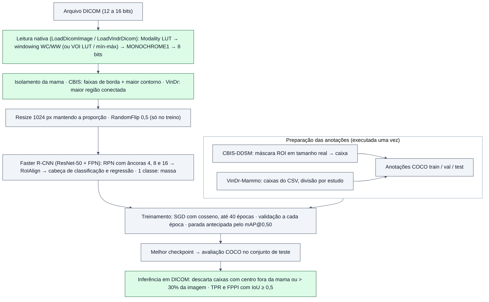

# Detecção de massas em mamografia com leitura nativa de DICOM

Trabalho de Conclusão de Curso (Engenharia) — Rafael

Este repositório estende o [Digital Eye for Mammography](https://github.com/cbddobvyz/digitaleye-mammography) (TERZI *et al.*, 2025) para:

- **ler exames DICOM diretamente**, sem conversão prévia para PNG, usando a janela de visualização clínica gravada no próprio arquivo (*windowing* WC/WW);
- **treinar os detectores localmente** com duas bases públicas de mamografia, o **CBIS-DDSM** (filme digitalizado) e o **VinDr-Mammo** (mamografia digital);
- **migrar o pipeline para o MMDetection 3.3** (o Digital Eye usa o 2.28);
- **combinar três detectores** (Faster R-CNN, FCOS e ATSS) com *Weighted Boxes Fusion*, como no Digital Eye.

O objetivo clínico é apoiar o radiologista na etapa de leitura, apontando a região de cada massa. Por isso, o critério de escolha do modelo é o **mAP@0,50**: localizar a massa, mesmo com a caixa imprecisa, já ajuda na leitura.

> Este é um projeto acadêmico. **Não é um dispositivo médico** e não deve ser usado para diagnóstico.

---

## Resultados principais

**VinDr-Mammo — conjunto de teste oficial** (219 imagens, 237 massas; contagens em [`resultados/logs/README.md`](resultados/logs/README.md)):

| Modelo | mAP@0,50 | mAP@[0,50:0,95] | mAP@0,75 | TPR¹ | FPPI¹ |
|---|---|---|---|---|---|
| Faster R-CNN (ResNet-50 + FPN) | 58,7% | 27,7% | **24,6%** | **70,0%** | 1,44 |
| FCOS (ResNet-50 + FPN) | 60,0% | 21,8% | 10,8% | 64,1% | 0,35 |
| ATSS (ResNet-50 + FPN) | 57,9% | 28,3% | 22,9% | 49,8% | **0,21** |
| **Ensemble (WBF, pesos iguais)** | **60,5%** | **28,7%** | 20,5% | 66,2% | 0,58 |

¹ Sensibilidade (TPR) e falsos positivos por imagem (FPPI) com score ≥ 0,3 e IoU ≥ 0,5, pareamento 1 para 1 e **sem** os filtros de "fora da mama" e "caixa grande" (veja [Métricas](#métricas-tpr-e-fppi)).

A tabela sai de [`resultados/resultado_test.json`](resultados/resultado_test.json) (`python VinDR_ensemble.py --split test`). Os logs de todos os treinos e das avaliações no teste estão em [`resultados/logs/`](resultados/logs/README.md).

**Ensemble.** No teste, o ensemble reduziu o FPPI de 1,44 para 0,58 (−60%) ao custo de 3,8 pontos de TPR. Em mAP@0,50 (60,5%) ficou no mesmo patamar dos modelos individuais (57,9% a 60,7%). Sem intervalo de confiança, essas diferenças não permitem declarar um vencedor por mAP.

**Escolhas e uso do teste.** A configuração de referência (Faster R-CNN, 40 épocas, parada pelo mAP@0,50) foi escolhida pela validação. O `VinDR_train.py` avalia o melhor checkpoint no teste oficial ao fim de cada treino, portanto o resultado de teste de todas as variantes foi calculado. O recorte foi descartado por não melhorar a validação (68,0% contra 70,5%) nem o teste (56,8% contra 58,7%). Os pesos do ensemble `[1, 1, 1]` foram definidos antes da avaliação no teste; na validação foram comparados `[1, 1, 1]` e `[1, 0,5, 1]` e mantido o padrão do WBF: com pesos iguais, o ensemble teve mAP@0,50 de 71,7% contra 69,8%, TPR de 71,1% contra 72,2% e FPPI de 0,38 contra 0,49 ([`resultados/resultado_val_pesos_1-1-1.json`](resultados/resultado_val_pesos_1-1-1.json) e [`resultados/resultado_val_pesos_1-0.5-1.json`](resultados/resultado_val_pesos_1-0.5-1.json); o [`resultados/resultado_val.json`](resultados/resultado_val.json) é o de `[1, 0,5, 1]`).

**Modelo da defesa:** [PENDENTE: escolha final entre Faster R-CNN e ensemble]. A interface web carrega o Faster R-CNN de 40 épocas por padrão e o ensemble com `ENSEMBLE=1` (veja o `COMO_RODAR.md`).

**CBIS-DDSM — validação** (247 imagens, 260 massas), Faster R-CNN: **mAP@0,50 de 47,2%** e mAP@[0,50:0,95] de 19,0%.

> Os valores de mAP deste trabalho **não são comparáveis** aos do Digital Eye: lá, uma detecção conta como acerto com IoU ≥ 0,1 (avaliação no estilo VOC), e aqui são usadas as métricas do COCO (IoU de 0,50 a 0,95). As bases e o número de classes também são diferentes.

---

## Pipeline



1. **Leitura nativa do DICOM** — transformações próprias do MMDetection (`LoadDicomImage` para o CBIS-DDSM e `LoadVindrDicom` para o VinDr-Mammo): *Modality LUT* (`RescaleSlope`/`RescaleIntercept`) → *windowing* com `WindowCenter`/`WindowWidth` (ou *VOI LUT*, ou mínimo e máximo) → inversão de `MONOCHROME1` → 8 bits, 3 canais. A mesma função é usada no treino, na validação e na inferência.
2. **Isolamento da mama** — no CBIS-DDSM, faixas fixas de borda (etiquetas do filme) + maior contorno; no VinDr-Mammo, só a maior região conectada, para não cortar tecido junto à parede torácica.
3. **Anotações COCO** — no CBIS-DDSM, a caixa é calculada a partir da máscara ROI em tamanho real; no VinDr-Mammo, vem do `finding_annotations.csv`, com divisão por estudo e o teste oficial separado.
4. **Detector** — Faster R-CNN com ResNet-50 (ImageNet) + FPN, âncoras nas escalas 4, 8 e 16, uma classe (massa), imagens com lado maior de 1024 px.
5. **Treino** — SGD com decaimento em cosseno (até 40 épocas), validação a cada época, melhor checkpoint e parada antecipada pelo **mAP@0,50** (paciência de 8 épocas).
6. **Inferência e métricas** — TPR e FPPI com pareamento 1 para 1 (`metricas.py`), IoU ≥ 0,5 e score ≥ 0,3. Os filtros de detecções com centro fora da mama ou caixa maior que 30% da imagem são opcionais: a tabela de resultados não os usa, a CLI só os aplica com `--filtros` e a interface web os aplica por padrão.
7. **Ensemble** — Faster R-CNN + FCOS + ATSS fundidos com *Weighted Boxes Fusion* (SOLOVYEV; WANG; GABRUSEVA, 2021).

Para comparação, o pipeline original do Digital Eye está em [`docs/pipeline_digital_eye.png`](docs/pipeline_digital_eye.png).

---

## Estrutura do repositório

| Arquivo | Função |
|---|---|
| **CBIS-DDSM** | |
| `dicom_pipeline.py` | Leitura do DICOM com *windowing* e remoção de artefatos (`LoadDicomImage`) |
| `prepare_cbis_final.py` | Gera as anotações COCO a partir das máscaras ROI (divisão 80/20) |
| `mass_train.py` | Treinamento (`python mass_train.py [config]`) |
| `mass_inference_dicom_v2.py` | Inferência em um DICOM. **Atenção:** hoje só imprime as detecções; o PNG é salvo **sem as caixas** e o filtro de "fora da mama" não é aplicado ao resultado |
| `configs/cbis_faster_rcnn.py` | Faster R-CNN, 40 épocas, parada pelo mAP@0,50 |
| `configs/cbis_cascade_rcnn.py` | Cascade R-CNN com o mesmo agendamento |
| **VinDr-Mammo** | |
| `VinDR_pipeline.py` | Leitura do DICOM (`LoadVindrDicom`), isolamento da mama, recorte opcional e `VindrMammoDataset` |
| `VinDR_prepare.py` | Gera as anotações COCO: treino/validação por estudo e teste oficial |
| `VinDR_prepare_recorte.py` | Variante: anotações nas coordenadas do recorte da mama |
| `VinDR_train.py` | Treino + avaliação automática do melhor checkpoint no teste oficial |
| `VinDR_inference.py` | Inferência em arquivo ou pasta, com TPR, FPPI e CSV das detecções |
| `VinDR_ensemble.py` | Ensemble Faster R-CNN + FCOS + ATSS com WBF e avaliação COCO |
| `metricas.py` | TPR e FPPI (pareamento 1 para 1) e o limiar padrão `THR_PADRAO = 0,3`, usados pela CLI, pelo ensemble e pela interface |
| `val_loss_hook.py` | Hook que calcula a perda de validação a cada época (usado só pelo `configs/VinDR_faster_rcnn_200ep.py`) |
| `configs/VinDR_faster_rcnn.py` | Faster R-CNN (configuração de referência; é o modelo da interface web) |
| `configs/VinDR_fcos.py` | FCOS (um estágio, sem âncoras) |
| `configs/VinDR_atss.py` | ATSS (um estágio, seleção adaptativa de âncoras) |
| `configs/VinDR_faster_rcnn_200ep.py` | Experimento: 200 épocas sem parada, com perda de validação |
| `configs/VinDR_faster_rcnn_recorte.py` | Experimento: recorte da mama + Resize 1600 × 1024 |
| **Interface web** | |
| `main.py` | Backend (FastAPI): carrega o modelo e usa o `detectar()` do `VinDR_inference.py` |
| `index.html` | Interface (arquivo único, sem build) |
| `verificar.py` | Diagnóstico: diz se vai rodar com o modelo real ou em modo demo, e por quê |
| `iniciar.bat` / `iniciar.command` | Duplo clique para ligar tudo (Windows / macOS) |
| `gerar_test_dcm.py` | Gera um DICOM sintético (`test.dcm`) para testar a interface |
| `requirements-web.txt` | Dependências do backend web |
| `COMO_RODAR.md` / `CORRECOES.md` | Passo a passo da interface / histórico de inconsistências corrigidas |
| **Resultados e testes** | |
| `resultados/` | Resultados do ensemble (`resultado_*.json`) e logs de todos os treinos (`logs/`, com resumo em `logs/README.md`) |
| `tests/` | Testes automáticos de `metricas.py` (`python -m unittest discover tests`) |
| **Herdado do Digital Eye** (MMDetection 2.x; não usado pelo pipeline atual) | |
| `mass_inference.py` | Inferência do Digital Eye (depende de `utils/all_utils`, que não está no repositório) |
| `mammo_dataset.py` | Dataset do Digital Eye (API do MMDetection 2.x) |
| `yolo_v3_config.py` | Config YOLOv3 do Digital Eye |

---

## Instalação

Testado no Windows 11 com Python 3.9, PyTorch 2.1.0 + CUDA 12.1, MMCV 2.1.0, MMEngine 0.10.7 e MMDetection 3.3.0, em uma GPU RTX 4060 Laptop (8 GB).

```shell
python -m venv venv
venv\Scripts\activate

pip install torch==2.1.0 torchvision==0.16.0 --index-url https://download.pytorch.org/whl/cu121
pip install mmcv==2.1.0 -f https://download.openmmlab.com/mmcv/dist/cu121/torch2.1/index.html
pip install -r requirements.txt
```

Observações do ambiente:

- **Use Python 3.9** (ou 3.10–3.12). Versões mais novas não têm builds do PyTorch com CUDA compatíveis com esta pilha.
- **Instale o MMCV pré-compilado** (comando acima). Compilar no Windows exige uma versão do Visual Studio compatível com o CUDA instalado.
- Em redes com proxy institucional, acrescente `--trusted-host pypi.org --trusted-host files.pythonhosted.org` aos comandos do `pip`.
- Se aparecer `WinError 1455` ou `MemoryError` no *DataLoader*, aumente a memória virtual do Windows (`sysdm.cpl` → Avançado → Desempenho → Memória virtual) ou reduza `num_workers` no config.

---

## Dados

As imagens **não estão no repositório**: o CBIS-DDSM e o VinDr-Mammo têm termos de uso próprios. Baixe-os nas fontes oficiais:

- **CBIS-DDSM** — [The Cancer Imaging Archive (TCIA)](https://www.cancerimagingarchive.net/collection/cbis-ddsm/)
- **VinDr-Mammo** — [PhysioNet](https://physionet.org/content/vindr-mammo/) (exige cadastro e aceite do acordo de uso)

Os caminhos padrão são relativos à raiz do projeto. Organize os dados assim, ou altere as variáveis indicadas com `AJUSTE AQUI` nos scripts e `VINDR_ROOT` / `IMAGES_ROOT` / `ANNOTS_DIR` nos configs:

```
data/
├── CBIS-DDSM/
│   ├── mass_case_description_train_set.csv
│   ├── cbis_ddsm/            # pastas das máscaras ROI
│   └── imagens_completas/    # Mass-Training_P_xxxxx_LADO_INCIDENCIA/.../*.dcm
└── VinDr-Mammo/
    ├── finding_annotations.csv
    └── images/<study_id>/<image_id>.dicom
```

---

## Como usar

### VinDr-Mammo

```shell
# 1. Anotações COCO (train/val/test)
python VinDR_prepare.py

# 2. Treino de cada detector (avalia o melhor checkpoint no teste oficial ao final)
python VinDR_train.py configs/VinDR_faster_rcnn.py
python VinDR_train.py configs/VinDR_fcos.py
python VinDR_train.py configs/VinDR_atss.py

# 3. Ensemble: escolha os parâmetros na validação e reporte no teste
python VinDR_ensemble.py --split val
python VinDR_ensemble.py --split test

# Inferência em um exame ou em uma pasta
python VinDR_inference.py caminho\exame.dicom
python VinDR_inference.py caminho\pasta --config configs/VinDR_fcos.py
python VinDR_inference.py caminho\pasta --filtros     # descarta caixas fora da mama ou grandes
```

Outras opções do `VinDR_train.py`: `--retomar` (continua um treino interrompido), `--testar modelo.pth` (só avalia no teste) e `--sem-teste`.

Variante com recorte da mama:

```shell
python VinDR_prepare_recorte.py
python VinDR_train.py configs/VinDR_faster_rcnn_recorte.py
```

### CBIS-DDSM

```shell
python prepare_cbis_final.py
python mass_train.py configs/cbis_faster_rcnn.py
```

O `mass_inference_dicom_v2.py` não é recomendado por enquanto: ele não desenha as caixas no PNG de saída (veja a tabela de estrutura).

### Métricas (TPR e FPPI)

O `metricas.py` tem uma única função, `tpr_fppi()`, usada pelo `VinDR_inference.py` e pelo `VinDR_ensemble.py`:

- **Pareamento 1 para 1:** em cada imagem, as detecções com score ≥ `THR_PADRAO` (0,3) são percorridas da maior para a menor confiança; cada uma fica com a massa ainda livre de maior IoU. Com IoU ≥ 0,5 a massa conta como achada; senão, a detecção é um falso positivo. Duas caixas na mesma massa contam como 1 acerto + 1 falso positivo.
- **Filtros** (centro fora da mama, caixa maior que 30% da imagem): parâmetro `filtros` do `detectar()`. A tabela de resultados é **sem filtros**; a CLI só aplica filtros com `--filtros`; a interface web aplica filtros por padrão.
- **Os números da CLI mudaram** em relação à versão anterior, que contava como acerto qualquer detecção com IoU ≥ 0,5 em alguma massa (duas caixas na mesma massa não geravam falso positivo) e sempre aplicava os filtros.

### Interface web

Uma página para a apresentação: envia-se um DICOM, o modelo roda no backend e as detecções aparecem sobre a imagem, em camadas, com um controle de score mínimo (começa em 0,30, o mesmo limiar da CLI).

- **Modelo:** por padrão, carrega o Faster R-CNN de 40 épocas (`configs/VinDR_faster_rcnn.py`) e o `best_*.pth` mais recente do `work_dir` dele (ou da mesma subpasta em `WORK_DIRS`). Com `ENSEMBLE=1`, carrega Faster R-CNN, FCOS e ATSS e funde as caixas com WBF a cada imagem, com `carregar_modelos()` e `detectar_ensemble()` do `VinDR_ensemble.py` (pesos `1,1,1`, IoU 0,55, skip 0,05) e os mesmos filtros do modelo único.
- **Como subir:** duplo clique no `iniciar.bat` (Windows) ou no `iniciar.command` (macOS), ou `python -m uvicorn main:app --port 8000` e abrir http://localhost:8000.
- **Modo real × modo demo:** sem MMDetection, OpenCV ou checkpoint, o servidor sobe em **modo demo**, com caixas falsas e uma faixa amarela de aviso. O `GET /status` mostra o modo, o motivo, o detector, o config e o checkpoint carregados; o `python verificar.py` diz o que falta.

Passo a passo e problemas comuns: [`COMO_RODAR.md`](COMO_RODAR.md).

---

## Experimentos

| Experimento | Base | Conclusão |
|---|---|---|
| Caixas corretas a partir das máscaras ROI | CBIS-DDSM | A primeira versão gerava caixas inválidas (imagem inteira, depois todas em (0, 0)); corrigido lendo a máscara em tamanho real |
| Remoção de artefatos do filme | CBIS-DDSM | Sem ela, o modelo marcava etiquetas do digitalizador como massas |
| 12 × 40 épocas, parada pela perda × pelo mAP | CBIS-DDSM | Todas as configurações ficaram entre 44,5% e 47,2% de mAP@0,50; a perda de validação não serve como critério de parada no Faster R-CNN |
| Cascade R-CNN | CBIS-DDSM | Caixa um pouco melhor (mAP@0,75 de 12,2% contra 11,3%), mas menos massas encontradas (mAP@0,50 de 44,3%) |
| 200 épocas sem parada | VinDr-Mammo | Melhor época na 20ª (validação 69,2%, teste 60,7%); depois, overfitting (loss de treino −93%) |
| Recorte da mama (resolução 2,08×) | VinDr-Mammo | Melhorou as massas médias no teste (AP de 0,5% para 11,0%), sem ganho geral (mAP@0,50 de 68,0% na validação e 56,8% no teste) |
| Ensemble Faster R-CNN + FCOS + ATSS | VinDr-Mammo | FPPI de 1,44 para 0,58 (−60%) com 3,8 pontos a menos de TPR; mAP@0,50 no mesmo patamar dos modelos individuais |

Os números desta tabela estão em [`resultados/logs/README.md`](resultados/logs/README.md), com a pasta do log de cada execução.

---

## Limitações

- No CBIS-DDSM, a divisão treino/validação foi feita **por imagem** (80/20), e não por paciente; as duas incidências de uma mesma mama podem estar em conjuntos diferentes. No VinDr-Mammo a divisão é por estudo.
- O CBIS-DDSM ainda não foi avaliado no seu conjunto de teste oficial.
- A validação do VinDr-Mammo tem 97 massas: cada massa vale cerca de 1 ponto de mAP, e diferenças de 1 a 2 pontos entre modelos estão dentro da variação entre execuções.
- Só uma classe (massa) é detectada; a classificação benigno/maligno do Digital Eye não foi reproduzida.
- O teste do VinDr-Mammo tem **só imagens com massa** (exames "No Finding" ficaram de fora). O FPPI não reflete uma triagem real, em que a maioria dos exames é normal.
- O limiar de score (0,3) é fixo e não foi escolhido por uma curva FROC (TPR × FPPI).
- Não há intervalo de confiança para mAP, TPR e FPPI.
- Cada modelo do VinDr-Mammo foi treinado uma única vez, sem semente fixa nos configs. A única repetição é a do CBIS-DDSM (execuções D e E em `resultados/logs/README.md`: 46,8% e 45,5% de mAP@0,50).

---

## Referências

- TERZI, R. *et al.* The digital eye for mammography: deep transfer learning and model ensemble based open-source toolkit for mass detection and classification. **Signal, Image and Video Processing**, v. 19, n. 1, p. 170, 2025.
- LEE, R. S. *et al.* A curated mammography data set for use in computer-aided detection and diagnosis research. **Scientific Data**, v. 4, 170177, 2017.
- NGUYEN, H. T. *et al.* VinDr-Mammo: a large-scale benchmark dataset for computer-aided diagnosis in full-field digital mammography. **Scientific Data**, v. 10, 277, 2023.
- REN, S. *et al.* Faster R-CNN: towards real-time object detection with region proposal networks. NeurIPS, 2015.
- TIAN, Z. *et al.* FCOS: fully convolutional one-stage object detection. ICCV, 2019.
- ZHANG, S. *et al.* Bridging the gap between anchor-based and anchor-free detection via adaptive training sample selection. CVPR, 2020.
- SOLOVYEV, R.; WANG, W.; GABRUSEVA, T. Weighted boxes fusion: ensembling boxes from different object detection models. **Image and Vision Computing**, v. 107, 104117, 2021.
- CHEN, K. *et al.* MMDetection: open MMLab detection toolbox and benchmark. arXiv:1906.07155, 2019.

## Licença

Distribuído sob a licença **GNU GPL v3**, a mesma do [Digital Eye for Mammography](https://github.com/cbddobvyz/digitaleye-mammography), do qual este trabalho deriva. Veja [`LICENSE`](LICENSE).
